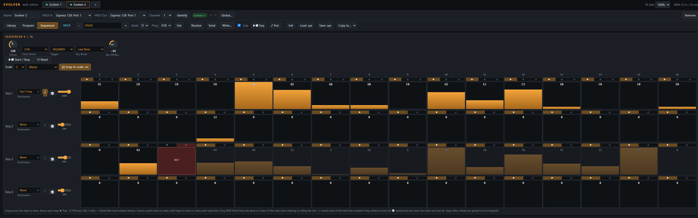

# Evolver Web Editor

A browser-based sound editor and librarian for the **Dave Smith Instruments Evolver (desktop mono)**, written in plain HTML/CSS/JavaScript and using the Web MIDI API.

It runs from one self-contained file (`evolver-editor.html`) with no build step, no dependencies and no server-side code.

Unlike the classic editors, it can **control several Evolvers at the same time**, with one tab per unit.

> Use at your own risk — see [Disclaimer](#disclaimer). Not affiliated with or endorsed by Sequential / Dave Smith Instruments. "Evolver" is used only to name the hardware this tool talks to.



---

## Features

### Multi-Evolver
- One tab per Evolver, each with its own MIDI In, MIDI Out and MIDI channel. Add or remove tabs with **+** and **Remove**.
- Each tab keeps its own edit buffer, current program, name and library cache.
- **Identify** sends a MIDI Universal Device Inquiry. A green badge confirms that an Evolver answered on that port pair.
- **Copy to…** copies the current program to another Evolver's tab and sends it to that unit's edit buffer.
- A warning appears if two tabs share a MIDI port. Evolver SysEx has **no device ID**, so each unit needs its own MIDI In/Out pair.

### Global parameters (button *Global…*)
- Opens a popup with the Evolver's Main (global) parameters for the current tab, read from the synth when it opens (**Reload** asks again):
  - Row 1: Master Volume, Transpose, BPM, Clock Divide, Use Program Tempo, MIDI Clock
  - Row 2: Lock Sequence, Poly Chain, Input Gain, Fine Tune, MIDI Receive, MIDI Channel
- Transpose and Fine Tune are bipolar: their slider fills from the centre, like a pan control. Double-click recentres it.
- MIDI Transmit is left out on purpose: setting it to Off would stop the Evolver answering the editor.
- Each change is sent at once (SysEx *Main Parameter*, type `09`). The Evolver keeps these settings when switched off.
- Changing the MIDI Channel to 1–16 also moves the tab's channel, so the editor keeps reaching the synth.
- Setting MIDI Receive to anything other than **All** can cut the editor off; a warning is shown in the log.

### Program editor (view *Program*)
- All 128 program parameters, grouped by section:
  - Oscillators 1–4
  - Osc 3 & 4 mods
  - Noise
  - External input
  - Envelope 3
  - Low-pass filter
  - Amp, with the Exp/Lin envelope curve
  - HP / Feedback / Distortion
  - Delay
  - Output
  - LFO 1–4
  - Modulators 1–4
  - Controllers
  - Tempo / Keys
- Knobs:
  - Drag vertically. Hold **Shift** for fine steps.
  - Use the mouse wheel. Hold **Shift** for steps of 1.
  - **Double-click** a knob to type a value. Display units are accepted: `-24`, `+12`, `C2`, `OFF`.
- List parameters use drop-downs, and two-state parameters use toggle buttons. Hover any control to see the parameter number and raw value.
- Envelope graphs for the filter envelope, the amp envelope and Envelope 3 (including its delay).
- **Live mode**: each change is sent at once as a SysEx *Program Parameter* message. Sending is throttled to about 12 ms per parameter.
- **Incoming edits**: if the Evolver transmits parameter changes (as SysEx), the editor follows the front-panel knobs.

### Sequencer (view *Sequencer*)
- A 4 × 16 grid, with a destination for each row.
- Tools:
  - **Draw**: drag across steps to set values from 0 to 100.
  - **RST**: marks the end of the sequence. Later steps are greyed out because they are not played.
  - **OFF**: a rest. Only Seq 1 has it.
  - **Clear**: sets a step to 0.
  - Clicking again with the same tool undoes the change.
  - Right-clicking a step cycles value → RST → OFF.
- Tempo, Clock Divide, Trigger mode, Key Mode and Key Off/Transpose.
- **Start/Stop** and **Reset** buttons, which act like the front-panel buttons. **▶■ Seq** is also available from every view.

### Library (view *Library*)
- Four columns, banks A–D × 128 programs.
- **Read all names** reads all 512 names, or use **Bank A–D** to read one bank. Requests go one at a time, each waiting for the reply (400 ms timeout), with a progress counter and a **Stop** button.
- Names are cached for each Evolver and kept between sessions.
- Click selects a program. Double-click does a program change and loads that program into the editor.
- A filter box searches by name or location.

### Program management
- **Get**: Bank Select (CC 32) and Program Change, then requests the edit buffer and the name.
- **− / +** on either side of the program name: go to the previous or next program, the same way as **Get**. It wraps across banks (A128 → B001, A001 → D128).
- **Receive**: requests the edit buffer, the current bank/program and its name.
- **Send**: sends the editor content to the Evolver's edit buffer. Nothing is stored.
- **Write…**: stores the program and its name to the selected bank/program, after a confirmation.
- **Init**: starts from a basic patch:
  - Osc 1 saw at full level; Osc 2–4 off
  - Low-pass filter wide open, no resonance
  - VCA envelope A0 D0 S100 R10
  - Output pan set to mono
  - Modulations, effects and sequencer off
- **Load .syx / Save .syx**: single program files (edit-buffer dump plus name dump). When loading, both program dumps and edit-buffer dumps are accepted.
- **♪ Test**: hold to play C3 on the selected channel.

### Interface
- **UI size** selector, from 100 % to 200 % (150 % by default). Works well on 4K screens.
- The view, UI size, ports, channels, current programs and name caches are saved in `localStorage`.

---

## Requirements

- **Chrome or Edge** (desktop). Firefox and Safari are not supported.
- A MIDI interface for each Evolver, connected both ways: Evolver MIDI Out → computer, and computer → Evolver MIDI In.
- On the Evolver, the global MIDI settings must allow SysEx to be received and, if you want the editor to follow the front panel, transmitted.

## Getting started

1. Download `evolver-editor.html`.
2. Open it in Chrome or Edge. When prompted, allow the page to **control and reprogram your MIDI devices** (this is the SysEx permission).
3. In each tab, choose the **MIDI In**, **MIDI Out** and **Channel** for one Evolver, then click **Identify**.
4. Click **Receive** to load the current sound, and start turning knobs.

If Chrome refuses SysEx for a local file, serve the folder over `http://localhost` instead. SysEx is only granted to secure origins: `https://` or `http://localhost`. Two ways:
- On Windows, double-click `start-editor.bat`, which needs Python.
- Or run this, then open `http://localhost:8765/evolver-editor.html`:

```
python -m http.server 8765
```

The page can also be hosted on GitHub Pages, which serves it over `https`.

---

## Technical specification

### Web MIDI
- `navigator.requestMIDIAccess({ sysex: true })`.
- Incoming messages go to every tab whose MIDI In resolves to the receiving port.
- Ports are matched by ID first, then by name, so the settings survive reconnects.

### SysEx header
All Evolver messages start with `F0 01 20 01 <type>` and end with `F7`. In that header:
- `01` is the DSI manufacturer ID.
- `20` is the Evolver ID.
- `01` is the file version.

| Type | Message | Body (after type) | Used for |
|---|---|---|---|
| `01` | Program parameter | `pp` `vL` `vH` (value as LS nibble, MS nibble) | live edits, both directions |
| `02` | Program dump | `bank` `prog` + 220 packed bytes | Write; read when received |
| `03` | Edit buffer dump | 220 packed bytes | Send / Receive / .syx |
| `04` | Reset button | — | sequencer reset |
| `05` | Request program dump | `bank` `prog` | (reserved for the librarian) |
| `06` | Request edit buffer | — | Receive, Get |
| `08` | Sequence step parameter | `step` (0–63) `vL` `vH` | live sequencer edits |
| `09` | Main parameter | `pp` (0–14) `vL` `vH` | Global popup |
| `0E` | Request main parameters | — | find the current bank/program |
| `0F` | Main parameter dump | 16 × (LS, MS) nibbles | bank = param 1, program = param 0; Global popup |
| `10` | Request program name | `bank` `prog` | library, Get, Receive |
| `11` | Program name dump | `bank` `prog` + 16 ASCII bytes | names; also sent on Write |
| `12` | Start/Stop button | — | sequencer start/stop |

Universal Device Inquiry: request `F0 7E 7F 06 01 F7`. The reply is recognised when it carries manufacturer `01` and family `20`.

Program change: `Bn 20 <bank 0–3>` (CC 32), then `Cn <prog 0–127>`.

### Packed data format
Each 7 data bytes are sent as 8 MIDI bytes. The first byte of each packet holds the MS bits of the next 7 bytes (bit 0 = first byte), and those 7 bytes follow with their MS bit cleared. So 192 data bytes become **220** packed bytes (27 full packets + 1 packet of 3 bytes).

### Program data layout (192 bytes)
- Bytes **0–127**: program parameters (table below).
- Bytes **128–191**: sequencer, 4 sequences × 16 steps. Byte = 128 + seq × 16 + step, where seq and step are 0-based.
  - Step values: `0–100` · `101` = **RST** (end of sequence) · `102` = **OFF** (rest, Seq 1 only).
- The program name is **not** part of the dump. It is exchanged with message types `10`/`11`.

### Program parameters

Lists referenced below:
- **Mod destinations (0–68)**:
  - None
  - Osc 1–4 / All frequency
  - Osc 1–4 / All level
  - Noise level
  - Ext In level
  - Osc 1/2/All PW
  - FM 4>3, FM 3>4, RM 4>3, RM 3>4
  - Filter frequency, filter split, resonance
  - HP frequency
  - VCA amount, pan
  - Feedback frequency, feedback amount
  - Delay times 1/2/3/All, delay amounts 1/2/3/All, delay feedback 1/2
  - LFO 1–4/All frequency, LFO 1–4/All amount
  - Env 1/2/3/All amount, attack, decay and release
  - Filter L/R frequency, filter L/R resonance
  - Distortion
- **Sequencer destinations**: the same list plus 69 Clock Mult, 70 MIDI Note Out, 71 MIDI Velocity Out, 72 MIDI Mod Wheel Out, 73 MIDI Pressure Out, 74 MIDI Breath Out, 75 MIDI Foot Out.
- **Mod sources (0–24)**:
  - None
  - Seq 1–4
  - LFO 1–4
  - Filter Env, Amp Env, Env 3
  - Ext Peak, Ext Env Follower
  - Pitch Bend, Mod Wheel, Pressure, Breath, Foot
  - Velocity, Note Number, Expression
  - Noise, Osc 3, Osc 4

| # | Parameter | Range | Display / values |
|---:|---|---|---|
| 0 | Osc 1 Freq | 0–120 | note C0…C10 (semitones) |
| 1 | Osc 1 Fine | 0–100 | −50…+50 (50 = centre) |
| 2 | Osc 1 Shape | 0–102 | 0 Saw · 1 Tri · 2 Saw/Tri · 3–102 Pulse width 0–99 |
| 3 | Osc 1 Level | 0–100 | value |
| 4 | Osc 2 Freq | 0–120 | note C0…C10 (semitones) |
| 5 | Osc 2 Fine | 0–100 | −50…+50 (50 = centre) |
| 6 | Osc 2 Shape | 0–102 | 0 Saw · 1 Tri · 2 Saw/Tri · 3–102 Pulse width 0–99 |
| 7 | Osc 2 Level | 0–100 | value |
| 8 | Osc 3 Freq | 0–120 | note C0…C10 (semitones) |
| 9 | Osc 3 Fine | 0–100 | −50…+50 (50 = centre) |
| 10 | Osc 3 Shape | 0–127 | waveshape 1–128 (1–96 ROM, 97–128 user) |
| 11 | Osc 3 Level | 0–100 | value |
| 12 | Osc 4 Freq | 0–120 | note C0…C10 (semitones) |
| 13 | Osc 4 Fine | 0–100 | −50…+50 (50 = centre) |
| 14 | Osc 4 Shape | 0–127 | waveshape 1–128 (1–96 ROM, 97–128 user) |
| 15 | Osc 4 Level | 0–100 | value |
| 16 | LPF Frequency | 0–164 | value |
| 17 | LPF Env Amount | 0–198 | −99…+99 (99 = 0) |
| 18 | LPF Attack | 0–110 | value |
| 19 | LPF Decay | 0–110 | value |
| 20 | LPF Sustain | 0–100 | value |
| 21 | LPF Release | 0–110 | value |
| 22 | Resonance | 0–100 | value |
| 23 | LPF Key Amount | 0–100 | value |
| 24 | VCA Level | 0–100 | value |
| 25 | VCA Env Amount | 0–100 | value |
| 26 | VCA Attack | 0–110 | value |
| 27 | VCA Decay | 0–110 | value |
| 28 | VCA Sustain | 0–100 | value |
| 29 | VCA Release | 0–110 | value |
| 30 | Output Pan | 0–6 | Stereo 1 / Stereo 2 / Stereo 3 / Mono / Reverse 1 / Reverse 2 / Reverse 3 |
| 31 | Program Volume | 0–100 | value |
| 32 | Feedback Freq | 0–48 | note C0…C10 (semitones) |
| 33 | Feedback Level | 0–100 | value |
| 34 | Grunge | 0–1 | Off / On |
| 35 | Delay 1 Time | 0–166 | 0–150 time · 151–166 synced (s32…st6) |
| 36 | Delay 1 Amount | 0–100 | value |
| 37 | Delay FB to Delay | 0–100 | value |
| 38 | Delay FB to Filter | 0–100 | value |
| 39 | Output Hack | 0–14 | value |
| 40 | LFO 1 Freq | 0–160 | 0–150 free · 151–160 synced (s32…st16) |
| 41 | LFO 1 Shape | 0–4 | Triangle / Rev Saw / Saw / Pulse / Random |
| 42 | LFO 1 Amount | 0–200 | 0–100 · 101–200 key-sync (shown K1–K100, unverified) |
| 43 | LFO 1 Dest | 0–68 | mod destination list (0–68) |
| 44 | LFO 2 Freq | 0–160 | 0–150 free · 151–160 synced (s32…st16) |
| 45 | LFO 2 Shape | 0–4 | Triangle / Rev Saw / Saw / Pulse / Random |
| 46 | LFO 2 Amount | 0–200 | 0–100 · 101–200 key-sync (shown K1–K100, unverified) |
| 47 | LFO 2 Dest | 0–68 | mod destination list (0–68) |
| 48 | Env 3 Amount | 0–198 | −99…+99 (99 = 0) |
| 49 | Env 3 Dest | 0–68 | mod destination list (0–68) |
| 50 | Env 3 Attack | 0–110 | value |
| 51 | Env 3 Decay | 0–110 | value |
| 52 | Env 3 Sustain | 0–100 | value |
| 53 | Env 3 Release | 0–110 | value |
| 54 | Trigger Select | 0–13 | SEQ/MIDI / SEQUENCER / MIDI / MIDI RST / MIDI GATE / MIDI G/R / EXT IN / EXT IN RST / EXT IN GATE / EXT IN G/R / MIDI SEQ 1 / MIDI SEQ 1R / EXT IN SQ 1 / MIDI SQ SP |
| 55 | Key Off / Transpose | 0–73 | 0 = MIDI off · 1–73 = −36…+36 (37 = 0) |
| 56 | Seq 1 Dest | 0–75 | mod destinations + 69–75 (clock mult, MIDI outs) |
| 57 | Seq 2 Dest | 0–75 | mod destinations + 69–75 (clock mult, MIDI outs) |
| 58 | Seq 3 Dest | 0–75 | mod destinations + 69–75 (clock mult, MIDI outs) |
| 59 | Seq 4 Dest | 0–75 | mod destinations + 69–75 (clock mult, MIDI outs) |
| 60 | Noise Level | 0–100 | value |
| 61 | Ext In Volume | 0–100 | value |
| 62 | Ext In Mode | 0–3 | Stereo / Left / Right / Split |
| 63 | Input Hack | 0–14 | value |
| 64 | Osc 1 Glide | 0–200 | 0–100 glide · 101–199 fingered · 200 osc off for MIDI |
| 65 | Osc Sync | 0–1 | Off / On |
| 66 | Program Tempo | 30–250 | BPM |
| 67 | Clock Divide | 0–12 | 1/2 / 1/4 / 1/8 / 1/8 half swing / 1/8 full swing / 1/8 triplet / 1/16 / 1/16 half swing / 1/16 full swing / 1/16 triplet / 1/32 / 1/32 triplet / 1/64 triplet |
| 68 | Osc 2 Glide | 0–200 | 0–100 glide · 101–199 fingered · 200 osc off for MIDI |
| 69 | Osc Slop | 0–5 | value |
| 70 | Pitch Bend Range | 0–12 | semitones |
| 71 | Key Mode | 0–5 | Low Note / Low Note Retrig / High Note / High Note Retrig / Last Note / Last Note Retrig |
| 72 | Osc 3 Glide | 0–200 | 0–100 glide · 101–199 fingered · 200 osc off for MIDI |
| 73 | FM Osc 4>3 | 0–100 | value |
| 74 | Shape Mod Osc 3 | 0–4 | Off / Seq 1 / Seq 2 / Seq 3 / Seq 4 |
| 75 | Ring Mod 4>3 | 0–100 | value |
| 76 | Osc 4 Glide | 0–200 | 0–100 glide · 101–199 fingered · 200 osc off for MIDI |
| 77 | FM Osc 3>4 | 0–100 | value |
| 78 | Shape Mod Osc 4 | 0–4 | Off / Seq 1 / Seq 2 / Seq 3 / Seq 4 |
| 79 | Ring Mod 3>4 | 0–100 | value |
| 80 | Filter Poles | 0–1 | 2-Pole / 4-Pole |
| 81 | LPF Velocity | 0–100 | value |
| 82 | LPF Audio Mod | 0–100 | value |
| 83 | LPF L/R Split | 0–100 | value |
| 84 | Highpass | 0–199 | 0–99 on output · 100–199 on input |
| 85 | Mod 1 Source | 0–24 | mod source list (0–24) |
| 86 | Mod 1 Amount | 0–198 | −99…+99 (99 = 0) |
| 87 | Mod 1 Dest | 0–68 | mod destination list (0–68) |
| 88 | Envelope Shape | 0–1 | Exp / Lin |
| 89 | VCA Velocity | 0–100 | value |
| 90 | Mod 2 Source | 0–24 | mod source list (0–24) |
| 91 | Mod 2 Amount | 0–198 | −99…+99 (99 = 0) |
| 92 | Mod 2 Dest | 0–68 | mod destination list (0–68) |
| 93 | Mod 3 Source | 0–24 | mod source list (0–24) |
| 94 | Mod 3 Amount | 0–198 | −99…+99 (99 = 0) |
| 95 | Mod 3 Dest | 0–68 | mod destination list (0–68) |
| 96 | Mod 4 Source | 0–24 | mod source list (0–24) |
| 97 | Mod 4 Amount | 0–198 | −99…+99 (99 = 0) |
| 98 | Mod 4 Dest | 0–68 | mod destination list (0–68) |
| 99 | Delay 2 Time | 0–166 | 0–150 time · 151–166 synced (s32…st6) |
| 100 | Delay 2 Amount | 0–100 | value |
| 101 | Delay 3 Time | 0–166 | 0–150 time · 151–166 synced (s32…st6) |
| 102 | Delay 3 Amount | 0–100 | value |
| 103 | Distortion | 0–199 | 0–99 on output · 100–199 on input |
| 104 | LFO 3 Freq | 0–160 | 0–150 free · 151–160 synced (s32…st16) |
| 105 | LFO 3 Shape | 0–4 | Triangle / Rev Saw / Saw / Pulse / Random |
| 106 | LFO 3 Amount | 0–200 | 0–100 · 101–200 key-sync (shown K1–K100, unverified) |
| 107 | LFO 3 Dest | 0–68 | mod destination list (0–68) |
| 108 | LFO 4 Freq | 0–160 | 0–150 free · 151–160 synced (s32…st16) |
| 109 | LFO 4 Shape | 0–4 | Triangle / Rev Saw / Saw / Pulse / Random |
| 110 | LFO 4 Amount | 0–200 | 0–100 · 101–200 key-sync (shown K1–K100, unverified) |
| 111 | LFO 4 Dest | 0–68 | mod destination list (0–68) |
| 112 | Env 3 Delay | 0–100 | value |
| 113 | Env 3 Velocity | 0–100 | value |
| 114 | Ext Peak Amount | 0–198 | −99…+99 (99 = 0) |
| 115 | Ext Peak Dest | 0–68 | mod destination list (0–68) |
| 116 | Env Follow Amount | 0–198 | −99…+99 (99 = 0) |
| 117 | Env Follow Dest | 0–68 | mod destination list (0–68) |
| 118 | Velocity Amount | 0–198 | −99…+99 (99 = 0) |
| 119 | Velocity Dest | 0–68 | mod destination list (0–68) |
| 120 | Mod Wheel Amount | 0–198 | −99…+99 (99 = 0) |
| 121 | Mod Wheel Dest | 0–68 | mod destination list (0–68) |
| 122 | Pressure Amount | 0–198 | −99…+99 (99 = 0) |
| 123 | Pressure Dest | 0–68 | mod destination list (0–68) |
| 124 | Breath Amount | 0–198 | −99…+99 (99 = 0) |
| 125 | Breath Dest | 0–68 | mod destination list (0–68) |
| 126 | Foot Amount | 0–198 | −99…+99 (99 = 0) |
| 127 | Foot Dest | 0–68 | mod destination list (0–68) |

### Not implemented (yet)
- Global (main) parameters: MIDI clock mode, channel, transpose, and so on.
- Full bank dumps (program data for whole banks) and bank `.syx` files.
- Waveshape (user wave 97–128) dumps.

### Known uncertainties
These values come from the Evolver manual but are ambiguous there. They have only been partly checked against hardware:
- The names of the synced delay times above 150 (`s32 … st6`).
- LFO amount above 100 is shown as key-sync (`K1…K100`).
- External input mode has 4 entries (Stereo / Left / Right / Split), although the manual's range says 0–2.

---

## Contributing / new features

This project was designed and written with **Claude** (Anthropic). If you want a new feature, the quickest route is:

1. **Fork** this repository.
2. Open `evolver-editor.html` with Claude (claude.ai, or Claude Code in your fork) and describe the feature you want, for example "add a Global panel for the MIDI clock settings" or "add bank backup to .syx".
3. Test it with your Evolver. Pull requests are welcome if you think others will benefit.

Issues with clear hardware reports (OS version, what you clicked, what the Evolver displayed) are very welcome too.

## Disclaimer

**Use this editor at your own risk.** The author accepts no liability for any damage or loss that results from using it, in particular:

- **Data loss.** *Write…* and incoming dumps overwrite programs on the synth, and you cannot undo this from the editor.
- **Unexpected behaviour** of your Evolver or of other MIDI equipment.
- **Hardware damage of any kind.**

Back up your banks with another tool before you write programs. The software is provided "as is", without warranty of any kind, as stated in the MIT license.

## License

[MIT](LICENSE)