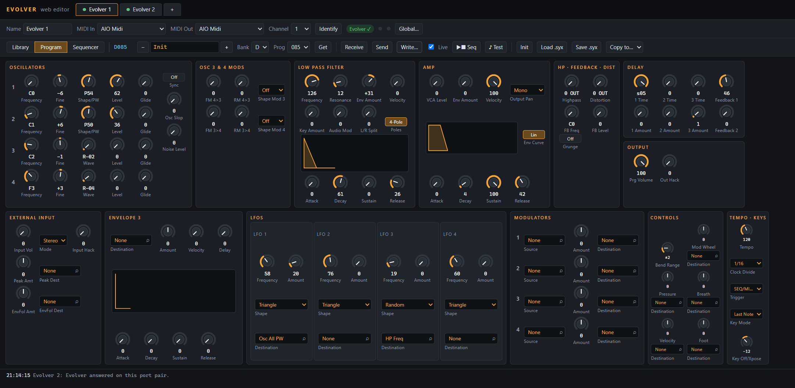
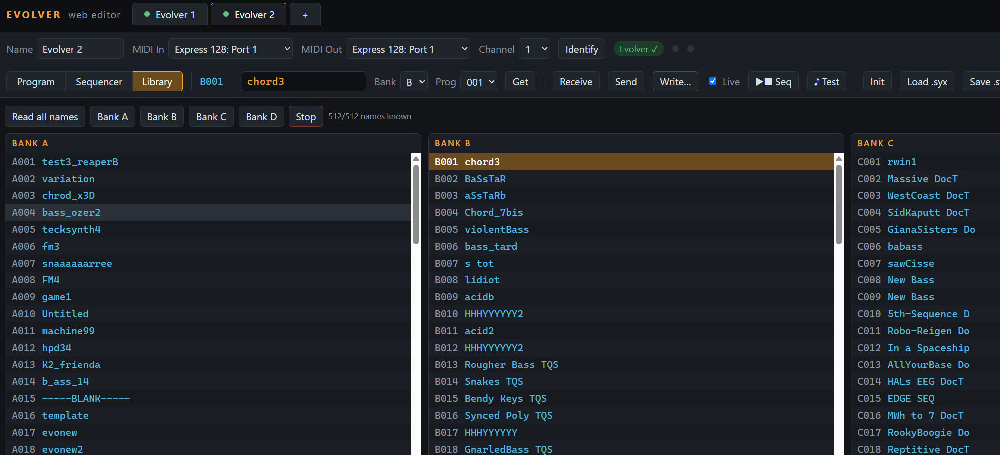

# Evolver Web Editor

A browser-based sound editor and librarian for the **Dave Smith Instruments Evolver (desktop mono)**, written in plain HTML/CSS/JavaScript and using the Web MIDI API.

It runs from one self-contained file (`evolver-editor.html`) with no build step, no dependencies and no server-side code.

Unlike the classic editors, it can **control several Evolvers at the same time**, with one tab per unit.

> Use at your own risk — see [Disclaimer](#disclaimer). Not affiliated with or endorsed by Sequential / Dave Smith Instruments. "Evolver" is used only to name the hardware this tool talks to.



---

## Features

### Multi-Evolver
- One tab per Evolver, each with its own MIDI In, MIDI Out and MIDI channel. Add or remove tabs with **+** and **Remove**.
- Each tab keeps its own edit buffer, current program, name and library cache.
- **Identify** sends a MIDI Universal Device Inquiry. A green badge confirms that an Evolver answered on that port pair.
- **Copy to…** copies the current program to another Evolver's tab and sends it to that unit's edit buffer.
- A warning appears if two tabs share a MIDI port. Evolver SysEx has **no device ID**, so each unit needs its own MIDI In/Out pair.

### Global parameters (button *Global…*)
- Opens a popup with the Evolver's Main (global) parameters for the current tab, read from the synth when it opens (**Reload** asks again):
  - Row 1: Master Volume, Transpose, BPM, Clock Divide, Use Program Tempo, MIDI Clock
  - Row 2: Lock Sequence, Poly Chain, Input Gain, Fine Tune, MIDI Receive, MIDI Channel
- Transpose and Fine Tune are bipolar: their slider fills from the centre, like a pan control. Double-click recentres it.
- MIDI Transmit is left out on purpose: setting it to Off would stop the Evolver answering the editor.
- Each change is sent at once (SysEx *Main Parameter*, type `09`). The Evolver keeps these settings when switched off.
- Changing the MIDI Channel to 1–16 also moves the tab's channel, so the editor keeps reaching the synth.
- Setting MIDI Receive to anything other than **All** can cut the editor off; a warning is shown in the log.

### Program editor (view *Program*)
- All 128 program parameters, on two lines of panels. Panels on the same line share its height.
  - Sound path: Oscillators 1–4 (with sync, slop and noise level), Osc 3 & 4 mods, Low-pass filter, Amp (with the Exp/Lin envelope curve), HP / Feedback / Distortion, Delay and Output.
  - Modulation: External input, Envelope 3, LFO 1–4, Modulators 1–4, then two compact columns: Controls (pitch bend range, then the mod wheel, pressure, breath, velocity and foot amounts, each with its destination) and Tempo / Keys.
  - The envelope graphs and the LFO boxes grow to fill the height of their panel.
  - At 150 % UI size, the layout fits a 2560 × 1440 window. On a narrower window the panels wrap.
- Knobs:
  - Drag vertically. Hold **Shift** for fine steps.
  - Use the mouse wheel: one step per notch. Hold **Shift** for steps of 10.
  - **Double-click** a knob to type a value. Display units are accepted: `-24`, `+12`, `C2`, `OFF`.
- List parameters use drop-downs, and two-state parameters use toggle buttons. Hover any control to see the parameter number and raw value.
- Mod sources and destinations (LFOs, Env 3, mod slots, controllers, sequencer rows) open a searchable picker, grouped by category (Oscillators, Filter, Delay, LFO, Envelopes…). Type to filter (`delay 2`, `osc1`, `env att`), use the arrow keys and Enter to choose, Esc to close. The mouse wheel steps through the list.
- Envelope graphs for the filter envelope, the amp envelope and Envelope 3 (including its delay).
- **Live mode**: each change is sent at once as a SysEx *Program Parameter* message. Sending is throttled to about 12 ms per parameter.
- **Incoming edits**: if the Evolver transmits parameter changes (as SysEx), the editor follows the front-panel knobs.

### Sequencer (view *Sequencer*)
- A 4 × 16 grid, with a destination for each row.
- Drag across the steps to draw values from 0 to 100. Drawing is always on.
- A **radio above each step of each track**:
  - **▶ Play**: the step is played. Switching back to Play restores the value hidden by Off or Reset.
  - **∅ Off** (Seq 1 only): a rest. Every track follows Seq 1's rests.
  - **↺ Reset**: RST, the track restarts there. Later steps of that track are greyed out because they are not played.
- **♪ Note mode** per track, available when the destination is an oscillator Freq or *MIDI Note Out*: steps show as note names (C3, D#3…). For an oscillator, 24 steps = 1 octave, counted from that oscillator's Freq, so odd values are quarter tones (shown with a +). The **↓ note** under ♪ is the lowest note of the track (step value 0): the sequence plays upwards from the oscillator Freq. Use the mouse wheel on it to move that Freq (Shift = one octave). For MIDI Note Out, note = value + 1 + master transpose.
- **Scale** (root + mode: major, minor, modes, pentatonics, blues, whole tone) and a **Snap to scale** switch. When it is on, every pitch track (Osc Freq or MIDI Note Out destination, with or without ♪) only lands on notes of the scale, both when drawing and with the die.
- **🎲 Die** per track, with a strength slider: each played step moves by a random amount. At 100 % the values are fully random; in note mode the range is ± 1 octave. With Snap on, the results of a pitch track stay on the scale.
- Tempo, Clock Divide, Trigger mode, Key Mode and Key Off/Transpose.
- **Start/Stop** and **Reset** buttons, which act like the front-panel buttons. **▶■ Seq** is also available from every view.

### Library (view *Library*)
- Four columns, banks A–D × 128 programs.
- **Read all names** reads all 512 names, or use **Bank A–D** to read one bank. Requests go one at a time, each waiting for the reply (400 ms timeout), with a progress counter and a **Stop** button.
- Names are cached for each Evolver and kept between sessions.
- Click selects a program. Double-click does a program change and loads that program into the editor.
- A filter box searches by name or location.

### Program management
- **Get**: Bank Select (CC 32) and Program Change, then requests the edit buffer and the name.
- **− / +** on either side of the program name: go to the previous or next program, the same way as **Get**. It wraps across banks (A128 → B001, A001 → D128).
- **Receive**: requests the edit buffer, the current bank/program and its name.
- **Send**: sends the editor content to the Evolver's edit buffer. Nothing is stored.
- **Write…**: stores the program and its name to the selected bank/program, after a confirmation.
- **Init**: starts from a basic patch:
  - Osc 1 saw at full level; Osc 2–4 off
  - Low-pass filter wide open, no resonance
  - VCA envelope A0 D0 S100 R10
  - Output pan set to mono
  - Modulations, effects and sequencer off
- **Load .syx / Save .syx**: single program files (edit-buffer dump plus name dump). When loading, both program dumps and edit-buffer dumps are accepted.
- **♪ Test**: hold to play C3 on the selected channel.

### Interface
- **UI size** selector, from 100 % to 200 % (150 % by default). Works well on 4K screens.
- The view, UI size, ports, channels, current programs and name caches are saved in `localStorage`.

---

## Release notes

### 2026-11-27
**Changed**
- **Sequencer** redesigned: a Play / Off / Reset radio above each step of each track (Off on Seq 1 only) replaces the Draw / RST / OFF / Clear tools (and the right-click shortcut). Drawing is always on.

**New**
- **Note mode** per sequencer track, with note names for oscillator and MIDI Note Out destinations.
- **Scale** selector with a *Snap to scale* switch: drawing on note tracks lands only on notes of the scale.
- **Die** per track to randomise it, with a strength setting.

### 2026-11-26
**New**
- **Global parameters** popup (button *Global…*): master volume, transpose, BPM, clock divide, MIDI clock, poly chain, input gain, fine tune, MIDI receive and channel. MIDI Transmit is left out on purpose: setting it to Off would cut the editor off.
- **Searchable picker** for mod sources and destinations, grouped by category, with keyboard filtering.
- **− / +** buttons on either side of the program name to step through the 512 programs.

**Changed**
- **Program view** redesigned: two lines of equal-height panels. The envelope graphs and the LFO boxes fill their panel. Noise level moved to Oscillators, and bend range to Controls.
- View order is now **Library · Program · Sequencer**.
- **Mouse wheel**: one step per notch on every knob (it was 2 on wide-range knobs). Hold **Shift** for steps of 10.
- Transpose and Fine Tune in the Global popup use bipolar sliders that fill from the centre, like a pan control.

**Fixed**
- **UI size** had no effect: the page stayed at the same size whatever the setting.

### 2026-11-25
- First release: multi-Evolver program editor, sequencer and library.

---

## Requirements

- **Chrome or Edge** (desktop). Firefox and Safari are not supported.
- A MIDI interface for each Evolver, connected both ways: Evolver MIDI Out → computer, and computer → Evolver MIDI In.
- On the Evolver, the global MIDI settings must allow SysEx to be received and, if you want the editor to follow the front panel, transmitted.

## Getting started

1. Download `evolver-editor.html`.
2. Open it in Chrome or Edge. When prompted, allow the page to **control and reprogram your MIDI devices** (this is the SysEx permission).
3. In each tab, choose the **MIDI In**, **MIDI Out** and **Channel** for one Evolver, then click **Identify**.
4. Click **Receive** to load the current sound, and start turning knobs.

If Chrome refuses SysEx for a local file, serve the folder over `http://localhost` instead. SysEx is only granted to secure origins: `https://` or `http://localhost`. Two ways:
- On Windows, double-click `start-editor.bat`, which needs Python.
- Or run this, then open `http://localhost:8765/evolver-editor.html`:

```
python -m http.server 8765
```

The page can also be hosted on GitHub Pages, which serves it over `https`.

---

## Technical specification

### Web MIDI
- `navigator.requestMIDIAccess({ sysex: true })`.
- Incoming messages go to every tab whose MIDI In resolves to the receiving port.
- Ports are matched by ID first, then by name, so the settings survive reconnects.

### SysEx header
All Evolver messages start with `F0 01 20 01 <type>` and end with `F7`. In that header:
- `01` is the DSI manufacturer ID.
- `20` is the Evolver ID.
- `01` is the file version.

| Type | Message | Body (after type) | Used for |
|---|---|---|---|
| `01` | Program parameter | `pp` `vL` `vH` (value as LS nibble, MS nibble) | live edits, both directions |
| `02` | Program dump | `bank` `prog` + 220 packed bytes | Write; read when received |
| `03` | Edit buffer dump | 220 packed bytes | Send / Receive / .syx |
| `04` | Reset button | — | sequencer reset |
| `05` | Request program dump | `bank` `prog` | (reserved for the librarian) |
| `06` | Request edit buffer | — | Receive, Get |
| `08` | Sequence step parameter | `step` (0–63) `vL` `vH` | live sequencer edits |
| `09` | Main parameter | `pp` (0–14) `vL` `vH` | Global popup |
| `0E` | Request main parameters | — | find the current bank/program |
| `0F` | Main parameter dump | 16 × (LS, MS) nibbles | bank = param 1, program = param 0; Global popup |
| `10` | Request program name | `bank` `prog` | library, Get, Receive |
| `11` | Program name dump | `bank` `prog` + 16 ASCII bytes | names; also sent on Write |
| `12` | Start/Stop button | — | sequencer start/stop |

Universal Device Inquiry: request `F0 7E 7F 06 01 F7`. The reply is recognised when it carries manufacturer `01` and family `20`.

Program change: `Bn 20 <bank 0–3>` (CC 32), then `Cn <prog 0–127>`.

### Packed data format
Each 7 data bytes are sent as 8 MIDI bytes. The first byte of each packet holds the MS bits of the next 7 bytes (bit 0 = first byte), and those 7 bytes follow with their MS bit cleared. So 192 data bytes become **220** packed bytes (27 full packets + 1 packet of 3 bytes).

### Program data layout (192 bytes)
- Bytes **0–127**: program parameters 0–127, in the order of the Evolver manual (MIDI implementation, Program Parameter Data).
- Bytes **128–191**: sequencer, 4 sequences × 16 steps. Byte = 128 + seq × 16 + step, where seq and step are 0-based.
  - Step values: `0–100` · `101` = **RST** (end of sequence) · `102` = **OFF** (rest, Seq 1 only).
- The program name is **not** part of the dump. It is exchanged with message types `10`/`11`.

### Not implemented (yet)
- Full bank dumps (program data for whole banks) and bank `.syx` files.
- Waveshape (user wave 97–128) dumps.

### Known uncertainties
These values come from the Evolver manual but are ambiguous there. They have only been partly checked against hardware:
- The names of the synced delay times above 150 (`s32 … st6`).
- LFO amount above 100 is shown as key-sync (`K1…K100`).
- External input mode has 4 entries (Stereo / Left / Right / Split), although the manual's range says 0–2.

---

## Contributing / new features

This project was designed and written with **Claude** (Anthropic). If you want a new feature, the quickest route is:

1. **Fork** this repository.
2. Open `evolver-editor.html` with Claude (claude.ai, or Claude Code in your fork) and describe the feature you want, for example "add a Global panel for the MIDI clock settings" or "add bank backup to .syx".
3. Test it with your Evolver. Pull requests are welcome if you think others will benefit.

Issues with clear hardware reports (OS version, what you clicked, what the Evolver displayed) are very welcome too.

## Disclaimer

**Use this editor at your own risk.** The author accepts no liability for any damage or loss that results from using it, in particular:

- **Data loss.** *Write…* and incoming dumps overwrite programs on the synth, and you cannot undo this from the editor.
- **Unexpected behaviour** of your Evolver or of other MIDI equipment.
- **Hardware damage of any kind.**

Back up your banks with another tool before you write programs. The software is provided "as is", without warranty of any kind, as stated in the MIT license.

## License

[MIT](LICENSE)